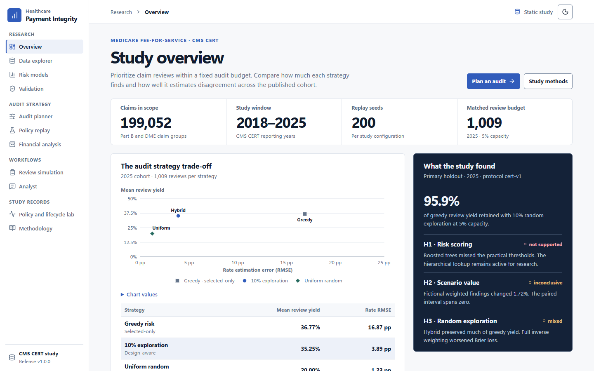

# Healthcare Payment Integrity

**Claim review optimization, financial risk and model validation**

A local research platform for prioritizing Medicare Fee-for-Service reviews under an audit budget. It uses 199,052 claim groups from eight CMS CERT public releases, covering Part B and durable medical equipment (DME). Its central experiment replays selective review and delayed feedback using historical outcomes. The local workspace adds a persisted synthetic review queue, decision receipts, shadow scoring and controlled candidate updates. The static workspace presents reviewed research and a browser-based fictional review exercise.

[Open the live static workspace](https://healthcare-payment-integrity.pages.dev/)

| Frozen 2025 comparison | Result |
| --- | --- |
| H1 · Boosted trees vs hierarchical lookup | The practical improvement criteria were **not supported**. Average precision changed by −0.00497, with a paired 97.5% interval of [−0.00930, 0.00005]. Precision at 5% changed by +0.10 percentage points, interval [−1.69, +2.28]. |
| H2 · Fictional value ranking vs risk ranking | **Inconclusive.** At 1,009 reviews, value ranking found 320 disagreements versus 365. Scenario-weighted findings rose 1.72%, interval [−2.60%, +7.82%], while nonfinding reviews per finding increased by 0.389, interval [0.178, 0.597]. |
| H3 · Exploration, design and learning | **Mixed.** At 5% capacity over 200 seeds, the 10% hybrid retained 95.9% of greedy yield. Rate RMSE was 3.89 percentage points for hybrid design-aware estimation, 16.87 for greedy’s selected-only rate and 1.23 for uniform design-aware estimation. Inverse weighting raised Brier loss by 0.00390 versus unweighted hybrid learning. |

The 2025 denominator is 20,180 eligible public claim groups, including 4,015 with at least one published disagreement. Public suppression limits what the sample represents. Disagreement is a review outcome. Financial values are fictional assumptions. The active lookup scorecard is research-only. [Research report](docs/REPORT.md) · [Evidence ledger](docs/EVIDENCE.md)



The workspace follows the system color scheme until you set a preference in the masthead. [Dark overview](docs/images/overview-dark.png) · [Mobile overview](docs/images/overview-mobile.png)

## Two-minute walkthrough

1. Start in **Overview**. Compare what each review strategy finds with how precisely it estimates disagreement in the released cohort.
2. Open **Audit planner**. Switch review capacity from 5% to 10%, then vary the exploration share. Compare each strategy at the same capacity and reset the scenario.
3. In **Policy replay**, inspect 95% interval coverage and the uniform reference. The selected-only and design-aware columns use different estimators.
4. Open **Review simulation**. Assign a fictional case, submit a finding, advance the simulated clock and record a correction. Inspect the receipt’s original inclusion probability.
5. Finish in **Validation** and **Risk models**. Check the active lookup, the challenger’s paired intervals and the frozen criteria it missed. [Walkthrough and local operations](docs/DEMO.md) · [Planner screenshot](docs/images/planner.png)

## Start locally on Windows

Prerequisites are PowerShell, Git, Python 3.13, uv and Node 24. From the repository root:

```powershell
$env:UV_CACHE_DIR = '.cache/uv'
uv sync --locked
$env:PYTHONPATH = 'src'
New-Item -ItemType Directory -Force .cache | Out-Null
.venv/Scripts/python.exe -m pytest -q --basetemp .cache/pytest
npm --prefix web ci --ignore-scripts
npm --prefix web run build
.venv/Scripts/python.exe -m payment_integrity.publication export
.venv/Scripts/python.exe scripts/serve_static.py
```

Open [the static study on loopback](http://127.0.0.1:4173/). It uses only the committed aggregate result and can be previewed without CMS downloads.

To build or restore the real-data registry, follow the [reproduction runbook](docs/REPRODUCIBILITY.md). With a local registry available, start two terminals in the project root:

```powershell
# Terminal 1
$env:PYTHONPATH = 'src'
.venv/Scripts/python.exe -m uvicorn payment_integrity.api:create_app --factory --host 127.0.0.1 --port 8000 --workers 1 --limit-concurrency 32 --no-access-log
# Terminal 2
npm --prefix web run dev
```

Open the operations workspace to intake a fictional batch, assign a review, advance the simulated clock and verify the finding history. The scoring and historical replay controls are under Scoring and replay. [Operations](http://127.0.0.1:5173/#/operations) · [Scoring and replay](http://127.0.0.1:5173/#/local) · [API reference](http://127.0.0.1:8000/docs)

## How it works

CMS CSVs are acquired with SHA-256 sidecars. DuckDB builds Parquet feature snapshots and separate development outcome tables. A frozen evaluator provides access to held-out outcomes. Python implements calibrated scorecards, matched-capacity planning, randomized sampling, design-aware estimators and delayed weighted learning. The local registry validates JSON model artifacts and serves them through FastAPI. React and TypeScript render an aggregate-only static build and a loopback-connected local mode.

| Area | Documentation |
| --- | --- |
| Data and rights | [Feasibility](docs/DATA_FEASIBILITY.md), [Data card](docs/DATA_CARD.md), [Licensing](docs/LICENSING.md) |
| Research | [Protocol](docs/research_protocol.md), [Development EDA](docs/DEVELOPMENT_EDA.md), [Report](docs/REPORT.md), [Repository audit](docs/AUDIT_REPORT.md), [Sources](docs/REFERENCES.md) |
| Extended experiments | [Registered protocol](docs/RESEARCH_PROTOCOL_EXTENSIONS.md), [Experiment report](docs/EXPERIMENT_REPORT.md) |
| Model risk | [Validation and model card](docs/MODEL_VALIDATION.md), [Limitations](docs/LIMITATIONS.md) |
| Operations | [Architecture and API](docs/ARCHITECTURE.md), [Operations runbook](docs/OPERATIONS_RUNBOOK.md), [Model lifecycle](docs/MODEL_LIFECYCLE.md), [Threat model](docs/THREAT_MODEL.md), [Performance](docs/PERFORMANCE.md) |
| Release | [Release notes](docs/RELEASE_NOTES.md), [Release audit](docs/RELEASE_AUDIT.md), [Traceability](docs/RELEASE_TRACEABILITY.md), [Tests](docs/TEST_EVIDENCE.md), [Workspace design](docs/UI_DESIGN.md), [Publication policy](docs/PUBLICATION_POLICY.md), [Static deployment](docs/DEPLOYMENT.md) |

The original implementation is MIT-licensed. CMS material and third-party components retain their own rights. The local export is in `release/static` after building.
