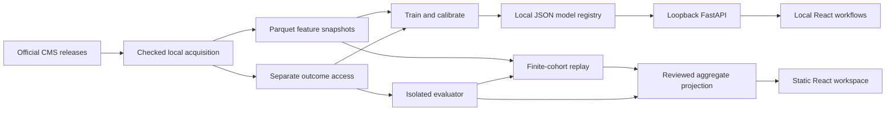

# Architecture and API



The code is a modular Python application. DuckDB is an embedded Parquet I/O engine. Predictive transforms stay in the model module and serve both training and inference. The model registry holds immutable version folders and an atomically replaced active pointer. Models use JSON lookup or coefficient states and native XGBoost JSON with digest validation. No pickle interface is used.

The evaluator verifies the Git freeze, source hashes, feature frame and allowed purpose before reading holdout outcomes. Policy selection receives immutable visible arrays and its own prior selected batches. Revealed labels contribute to model learning after their availability date. Selection evidence is checkpointed per seed with the stratum counts and selected row positions.

## Loopback routes

| Method and route | Contract |
| --- | --- |
| GET `/health`, `/ready` | Process health and verified research-only model availability. |
| GET `/v1/models`, `/v1/models/active` | Installed versions and provenance. |
| POST `/v1/score` | One claim with part, provider category, visible lines and number of provider categories. |
| POST `/v1/score/batch` | `claims` array, 1–500 entries. Returns ordered scores. |
| POST `/v1/audit-plan` | Claims, capacity, strategy and fictional financial scenario with optional count constraints. Time mode uses a minute budget. |
| POST `/v1/replay` | Seed count 1–10. Starts a local preview of the frozen historical experiment. |
| GET `/v1/runs` | Up to 20 recent local manifests, sorted by most recent update. |
| GET `/v1/runs/{id}` | Persistent job state and completed seed count. |
| POST `/v1/runs/{id}/cancel`, `/resume` | Cancel the local worker or resume eligible interrupted, failed or cancelled work. |
| GET `/v1/validation/{version}` | Verified model validation and monitor evidence. |

Requests use JSON. Illustrative scoring payload:

```json
{"part":"DME","provider_type":"Pharmacy","visible_lines":2,"provider_types":1}
```

Model output includes calibrated risk, feature schema, model version, evidence provenance, support and a deterministic explanation. Unseen or rare categories use documented fallback and flag the input. Individual intervals are unavailable. Errors have an `error.code` and `error.message`. The server binds to loopback by default, limits request bodies to 256,000 bytes and uses one bounded replay worker. Worker ownership is held by an OS-backed local lock. After an interrupted process, the next worker marks incomplete jobs interrupted and can resume them from validated seed evidence.

The static workspace reads only the published JSON and its own bundled assets. Hash routing supports local tabs without server-side routing. It can calculate bounded financial sensitivity in the browser. Local workflows use the API and display a research-only readiness status.

## Synthetic review operations

SQLite keeps simulated intake, review and finding history in a separate local database. Each command carries a schema version, synthetic source marker, event ID, idempotency key, run ID and simulation tick. The accepted envelope records the canonical payload digest and the tick at which the command was recorded. A submitted finding adds its own availability tick. The event, receipt and affected projections commit together. Equivalent retries return the prior acknowledgement. Conflicts and rejected actions retain redacted quarantine metadata.

| Method and route | Scope |
| --- | --- |
| POST `/v1/operations/events/{kind}` | `intake`, `assign`, `submit`, `correct`, `close`, `override` or `advance`. The `role` query parameter selects the demo permission. |
| GET `/v1/operations/overview` | Simulated clock, queue counts, recent runs, feature support, paired shadow feedback and request timings. |
| GET `/v1/operations/runs/{run_id}/cases` | Review state and revealed finding at `as_of`, defaulting to the current clock. |
| GET `/v1/operations/runs/{run_id}/estimate`, `/trace` | Design-aware outcome summary and redacted accepted event trace. |
| GET `/v1/operations/receipts/{case_id}`, `/integrity` | Decision receipt and verified event chain. Receipt history observes the requested availability cutoff. |
| GET `/v1/operations/lifecycle` | Reference, synthetic active and shadow versions with candidate reports. |
| POST `/v1/operations/lifecycle/train`, `/shadow`, `/promote`, `/rollback` | Bounded synthetic training and evidence-bound lifecycle actions. |
| POST `/v1/analyst/tool`, `/question` | Validated read-only analyst tools over reviewed aggregates and synthetic receipts. |

A receipt contains the synthetic case and run IDs, schema, payload and feature snapshot digests, verified model and calibration artifact reference, policy configuration digest, risk explanation, decision position and exact inclusion probability as integer numerator and denominator. The selection manifest reconstructs certainty and randomized strata. Every manual swap records a separate intervention and suspends the workspace estimate. The original receipt remains accessible alongside the intervention history and eligible finding versions. Receipt and event digests provide local integrity checks against a retained anchor. [Operations runbook](OPERATIONS_RUNBOOK.md)
